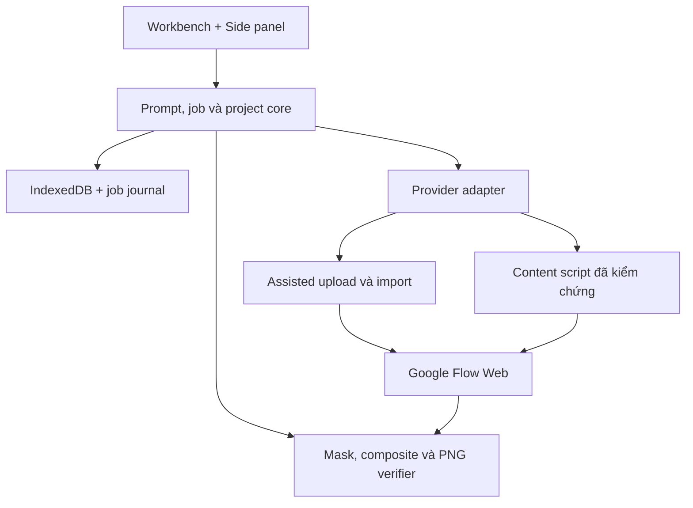
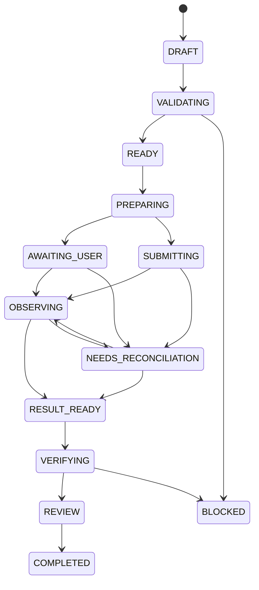

# 03 — Đặc tả kỹ thuật

## 1. Kiến trúc đề xuất

Stack: TypeScript, React, Vite, Chrome Manifest V3, IndexedDB, Canvas 2D cho tương tác, Web Worker cho xử lý pixel. Chốt phiên bản thư viện và lockfile tại kickoff; không dùng `latest` trong CI. Bộ core không phụ thuộc React hoặc DOM của Flow để kiểm thử độc lập.



Đường FLOW → IMAGE là dữ liệu ảnh candidate đã tải/nhập, không phải một API Flow được giả định. V2 có thể thêm provider API riêng phía backend; không dùng session Flow để xác thực API.

## 2. Module và ranh giới

| Module | Trách nhiệm | Không đảm nhận |
|---|---|---|
| `project-store` | CRUD, assets, revisions, migration, backup | Không gọi provider |
| `reference-resolver` | Active refs, roles, thứ tự, crop dẫn xuất, manifest | Không tự suy diễn danh tính |
| `prompt-compiler` | Canonical AST → text + source map + lint | Không gọi generate, không thêm parameter không hỗ trợ |
| `capability-registry` | Snapshot theo binding/model/mode, evidence, expiry | Không suy từ tên gói thuê bao |
| `job-orchestrator` | Job state, lock, deadline, event journal, reconcile | Không giữ trạng thái duy nhất trong RAM |
| `flow-web-adapter` | Đọc UI, đặt options, upload, submit/observe đã xác minh | Không đọc cookie/token, không gọi endpoint private |
| `mask-engine` | Coordinate transforms, binary mask, protect, inward feather | Không thay baseline |
| `image-compositor` | Candidate mapping, RGBA blend, verify, encode | Không tự mở rộng vùng sửa |
| `review-export` | Compare, approve, export, provenance | Không gắn nhãn Strict khi chưa kiểm tra file xuất |

## 3. Context trình duyệt

Chrome side panel là bề mặt extension phù hợp để đứng cạnh website [S04]. Content script thao tác DOM trong isolated world và gửi message về extension [S06]. Service worker có thể dừng; state quan trọng phải được lưu [S05].

Quyết định của sản phẩm:

- Workbench/side panel và service worker dùng chung IndexedDB theo extension origin. Content script không đọc DB đó trực tiếp.
- Service worker xử lý sự kiện ngắn, đăng ký listener ở top-level, ghi journal rồi trả về. Không dựa vào một `setTimeout` dài hoặc một Promise đợi generation sống hàng phút.
- Job đang ở Flow được content script quan sát khi tab tồn tại. Sau reconnect, orchestrator đọc journal và đối chiếu trạng thái UI; browser đóng thì processing phía Flow có thể vẫn diễn ra.
- Canvas/codec chạy trong Workbench hoặc worker con. Nếu đóng Workbench giữa bước local thì checkpoint đầu vào, tiếp tục khi mở lại; không cần giữ service worker chạy bằng heartbeat vô hạn.
- IndexedDB có transaction cho cập nhật job/event/lock. `chrome.storage.local` chỉ giữ preferences nhỏ và phiên bản migration; không chứa base64 ảnh hàng chục MB.

### 3.1 Permission budget

Quyền cơ bản đề xuất: `storage`, `sidePanel`, `scripting`, `activeTab`. `downloads` là optional khi bật tính năng download tự động. Host permissions chỉ yêu cầu khi kết nối Flow: origin được kiểm chứng như `https://labs.google/*` hoặc `https://flow.google/*`; code kiểm tra tiếp pathname Flow thuộc allowlist của adapter.

Không yêu cầu `<all_urls>`, `cookies`, `debugger`, `webRequest` chỉ để tạo ảnh. Không inject vào `accounts.google.com`. Trang extension không công khai assets người dùng bằng `web_accessible_resources`. Content script được register/inject sau quyền host, không chạy trên toàn bộ website.

CSP production: script đóng gói cục bộ, không `eval`, không remote JS/WASM; nếu codec cần WASM thì đóng gói và khai báo CSP tối thiểu phù hợp, kiểm thử riêng [S08]. Mặc định MVP dùng codec không cần nới CSP. Mọi config selector đi kèm extension version; remote kill switch nếu thêm sau chỉ tắt capability, không mang mã thực thi.

### 3.2 Messaging và file transfer nội bộ

Chrome messaging dùng dữ liệu JSON-serializable [S07]. Message chỉ truyền ID, trạng thái và metadata. Không giả định `Blob`/`ArrayBuffer` truyền qua `runtime.sendMessage` giống Web Worker structured clone.

Khi phải đưa file cho content script: chia base64 thành chunk với payload **tối đa 64 KiB ký tự** (giới hạn thiết kế, không phải giới hạn Chrome), kèm `transferId`, `assetHash`, `sequence`, `total`, checksum. ACK từng chunk, resume bằng index; timeout hủy transfer chưa hoàn tất. Content script dựng `File` sau khi hash/size trùng. Giới hạn một file đang dựng để tránh nhân bản RAM. Với Worker thuộc Workbench dùng transferable ArrayBuffer hợp lệ để giảm copy.

Validate mọi message bằng schema, kiểm tra `sender.id`, tabId, frameId = 0, origin/path và `bindingNonce` của kết nối. Sender tab không tự chọn job hoặc đọc asset ngoài project binding. Không cho page `postMessage` ra lệnh submit/đọc file. Có bridge là một capability riêng cần whitelist và threat test; MVP không cần bridge.

## 4. Dữ liệu và lưu trữ

| Entity | Trường chính | Bất biến |
|---|---|---|
| Project | id, name, schemaVersion, stylePresetId, revision | Mọi chỉnh sửa tăng revision |
| Asset | id, originalBlobKey, normalizedBlobKey, byteHash, pixelHash, W/H, MIME, orientation, normalizationVersion | Original immutable; bản chuẩn hóa có provenance |
| ReferenceBinding | id, assetId, roles, subjectKey, priority, include/avoid traits, active | Thứ tự được đóng băng tại job, không phụ thuộc reorder sau đó |
| PromptDocument | rawBrief, artStyle, structuredFields, compiledText, compilerVersion, sourceMap, warnings | Raw text không bị thay bởi compiled text |
| ConnectionBinding | id, tabId, origin, projectLocator, accountContextEpoch, nonce | Account/tab/project thay đổi làm capability cũ mất hiệu lực |
| CapabilitySnapshot | model labels, options, limits, support evidence, capturedAt, scope | Unknown khác false; gắn binding+mode+model |
| MaskRevision | baseAssetId, W/H, allowed/protect blobs, effective mask hash, feather, crop/transform | Chỉ dùng đúng baseline pixelHash tương ứng |
| GenerationJob | immutable intent, snapshotHash, state, revision, parentJobId, result provenance | Sau enqueue không sửa payload; sửa tạo job mới |
| JobEvent | eventId, jobId, sequence, previousState, nextState, timestamp, detail | Append-only; eventId dedup |
| ResultVersion | candidateId, compositeId, parentVersionId, review, strictReport | Composite không ghi đè candidate |

DB stores đề xuất: `projects`, `assets`, `blobs`, `references`, `prompts`, `masks`, `capabilities`, `jobs`, `events`, `results`, `locks`, `migrations`. Index theo projectId, state, createdAt. Không lưu raw signed download URL trong history lâu dài; chỉ giữ identifier không nhạy cảm và ảnh local.

Backup package chứa manifest có schemaVersion, assets bytes, masks, jobs và hashes. Import kiểm tra entry name/path traversal, MIME, file count, tổng bytes khai báo/thực tế và hashes. Backup/import là dữ liệu, không thực thi JS. Transaction validate toàn gói trước khi thay project. Blob garbage collection dựa trên reachability, không xóa original còn được version khác dùng.

## 5. Capability contract

Mỗi tính năng có `supported | unsupported | unknown`, nguồn evidence `observed_ui | user_confirmed | official_doc | fixture`, cùng ngày và scope. Chỉ `observed_ui` tươi, phù hợp selector pack mới được dùng cho DOM automation; `user_confirmed` cho Assisted; tài liệu chính thức chỉ gợi ý.

Snapshot lưu: selectable image models, active model/mode, supported ratios, resolution labels, output count options, max references nếu biết, accepted upload types/size nếu biết, text/image edit, native lasso visible, native mask import, automatic asset retrieval, costs nếu hiển thị.

**Không đồng nhất** `native lasso visible` với `programmatic mask import`. Một canvas cho người dùng vẽ chưa chứng minh extension có thể truyền bitmap mask vào đó.

Cache hiển thị tối đa 10 phút là lựa chọn sản phẩm; trước submit vẫn phải đọc lại model/mode/options/ref count. Đổi account, tab, project, locale, model, mode hoặc fingerprint UI thì invalidate. Nếu account không đọc được chắc chắn, UI yêu cầu người dùng xác nhận context và dùng epoch; không lưu email chỉ để làm lock.

## 6. Provider adapter

Interface chi tiết ở `contracts/domain.ts`. Các thao tác logic:

```text
probe(binding) -> capabilities + observed context
prepare(job) -> prepared input + required manual steps
readBack(prepared) -> observed options + ordered refs + prompt
submit(prepared, attemptId) -> accepted | rejected | unknown
reconcile(job) -> found output | still running | definitely absent | ambiguous
collect(job, selection) -> full-resolution asset | manual import required
cancel(job) -> confirmed cancelled | cancel unsupported | unknown
```

`prepare` có thể upload ảnh vào project nhưng không được bấm Generate. UI phải thông báo upload xảy ra trước khi gửi. Luồng Assisted trả hướng dẫn có thứ tự, cho người dùng xác nhận metadata họ đã chọn. Xác nhận thủ công được ghi đúng nguồn, không đổi thành `observed_ui`.

### 6.1 DOM recipe

1. Kiểm tra origin, route, binding, account epoch, project và trạng thái sẵn sàng.
2. Dùng role/name, label và thuộc tính ổn định đã quan sát. Chỉ thao tác khi tìm đúng **một** mục tiêu hiển thị/enabled; 0 hoặc nhiều mục tiêu thì dừng.
3. Đặt mode Image và model; đọc lại chip/label thực tế. Chuyển model xong phải chờ options cập nhật.
4. Upload từng ref theo manifest; đối chiếu thumbnail/count/order. Synthetic `File` + input/change chỉ dùng nếu G0 chứng minh Flow nhận; không gán đường dẫn local cho file input. Không nhận được thì nhờ upload file bằng người dùng.
5. Điền prompt theo control được hỗ trợ; so sánh text normalize newline, không bỏ chữ tùy tiện. Không tự dùng clipboard background.
6. Đặt ratio/resolution/output count được hỗ trợ và đọc lại.
7. Snapshot pre-submit gồm visible settings, ordered refs, promptHash, existing result IDs nếu có; ghi intent vào journal.
8. Bấm Generate đúng một lần bằng một command đã dedup. Ghi ACK nếu quan sát được; mất ACK thành unknown.
9. Quan sát card generation/trạng thái đã tương quan với job; không coi mọi ảnh mới nhất là kết quả của mình.

Selector pack versioned chứa locale, roles, anchor path, postcondition và fixture hash. Không cung cấp selector CSS bịa trong bộ docs. G0 phải tạo pack từ UI thật; test pack trên fixture đã loại bỏ prompts cá nhân/token trước release.

### 6.2 Lấy kết quả

MVP chắc chắn có đường **người dùng download từ Flow rồi import file**. Automatic collection chỉ bật khi luồng tải nguồn ảnh full-resolution được kiểm chứng. Content script bị ràng buộc same-origin; fetch từ extension cần host permission phù hợp [S09]. Không cho message từ web page biến service worker thành proxy fetch URL bất kỳ.

Nếu thêm host cho CDN, chỉ xin origin cần thiết sau khi xác định, chỉ fetch URL đã được adapter tin cậy liên kết với result, giới hạn MIME/bytes/redirect. Không dùng cookie extraction để vượt lỗi tải. Nếu có nhiều output mơ hồ, cho người dùng chọn thumbnail rồi xác nhận file; provenance là user-confirmed. Không tải lại bằng screenshot hoặc upscale thumbnail để giả ảnh gốc.

## 7. Máy trạng thái job



Trạng thái phụ: `PAUSED`, `FAILED`, `CANCEL_REQUESTED`, `CANCELLED`, `ABANDONED`. `BLOCKED` giữ reason/resumeState và inputs để người dùng sửa. `FAILED` chỉ khi kết quả thất bại được xác định. `ABANDONED` nghĩa không tiếp tục theo dõi ở Studio, không khẳng định Flow đã hủy.

### 7.1 Tránh submit trùng

- Job chứa `jobId`, payloadHash và intent immutable. Cố ý tạo lại cùng prompt là job mới với `parentJobId`; không dedup cứng bằng promptHash.
- Transaction lấy lock theo connected account scope, lưu ownerEpoch và expiry. Chỉ một coordinator được chuyển READY → PREPARING. Nếu không nhận diện được cùng tài khoản giữa các tab, V1 chỉ cho một Flow binding active trong profile.
- Trước click: ghi `submitAttemptId`, `SUBMITTING`, pre-submit evidence. Content script ghi/giữ attemptId đã thực hiện để dedup command lặp trong cùng document.
- Reload/crash đúng giữa click và ACK không thể giải quyết hoàn toàn bằng local id. Vì Flow không được giả định có idempotency key, trạng thái này luôn đi vào reconcile.
- Assisted cũng cần journal: trước khi hiện bước hướng dẫn bấm Generate, ghi `manualSubmissionWindowOpenedAt`. Nếu mất kết nối từ lúc này, `AWAITING_USER` phải reconcile vì người dùng có thể đã bấm trong Flow. Không coi thiếu xác nhận ở Studio là bằng chứng chưa gửi.
- Nếu không có bằng chứng chắc chắn request chưa tới Flow, **không tự gửi lại**. Hướng dẫn người dùng chọn kết quả hoặc xác nhận tạo một job mới có thể tiêu thêm credit.
- Thu hồi lock hết hạn không trao quyền submit lại. Coordinator mới phải reconcile mọi job ở SUBMITTING/OBSERVING trước.

### 7.2 Timeout, retry và hủy

Mốc khởi đầu đề xuất: thao tác UI 15 giây; upload 90 giây/file; chờ generation 5 phút trước khi hỏi kiểm tra; transfer chunk 10 giây. Đây là deadline giám sát có thể cấu hình, không phải thời gian Flow bảo đảm.

Chỉ retry tự động thao tác read/probe không có side effect, tối đa 3 lần với backoff/jitter. Upload đã timeout phải kiểm tra ảnh đã có chưa trước thử lại. Generate timeout/credit unknown không auto-retry. Nếu UI nêu retry-after thì tôn trọng, vẫn không bỏ qua reconcile.

Trước submit, Cancel hủy local job. Sau submit, chỉ hiển thị “đã hủy ở Flow” nếu provider xác nhận; nếu không thì dừng theo dõi/queue nhưng nói rõ generation có thể vẫn hoàn tất. Cancel không đồng nghĩa hoàn credit.

## 8. Bảo mật và dữ liệu

Ảnh/prompt ở IndexedDB local; chỉ refs được chọn mới gửi qua thao tác upload tới Flow. Không tự gửi toàn project. Log mặc định chỉ IDs, timings, error code, capability state; tắt full prompt, image data, tokens và signed querystrings. Diagnostic export cho phép review/redact trước khi chia sẻ.

Ref file name, OCR text hoặc metadata là dữ liệu, không thành instruction điều khiển extension. Không có đường để nội dung trong một ảnh gọi shell, đổi provider hoặc upload tài liệu khác. Validate file magic bytes, dimensions, decompression limits, SVG/HTML rejection và thông báo lỗi file hỏng.

Backend tùy chọn không nhúng shared API key vào bundle; dùng backend authentication riêng và quota. API credential không được suy từ đăng nhập Flow. Không quảng bá automation đã được Google bảo chứng chỉ vì trang web cho phép thao tác thủ công.

## 9. Non-functional requirements

Mục tiêu local trên PC RAM 16 GB, Chrome stable và một ảnh 4096×4096: kéo vẽ preview p95 dưới 33 ms/frame, autosave metadata trong 1 giây sau debounce, composite+verify dưới 5 giây, idle Workbench không leak tăng RAM qua 50 lượt edit. Đây là mục tiêu cần đo; không phải benchmark hiện có.

Decode tuần tự, thumbnail riêng, pixel processing theo tile nếu cần; không giữ 24 ảnh gốc ở dạng RGBA cùng lúc. Quan sát quota bằng Storage API, cảnh báo ở 80% dung lượng đã cấp, không tự xóa refs để “giải phóng RAM”. Khôi phục sau crash và số liệu pixel invariant ưu tiên hơn animation UI.
